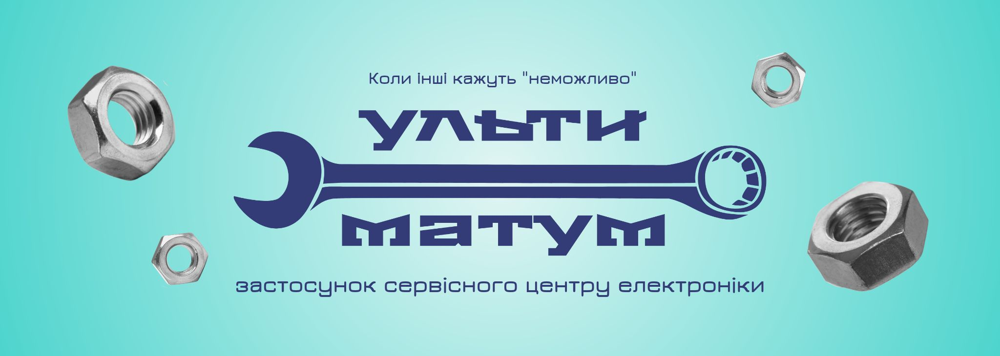

# Ультиматум – сервісний центр електроніки

### Курсова робота з дисципліни "Організація баз даних"

Веб-застосунок сервісного центру. Клієнти подають заявки на ремонт, майстри ведуть свої замовлення, адміністратор керує майстрами, клієнтами, пристроями, гарантіями, запчастинами та звітами.

## Стек

- **Фронтенд:** React 18, React Router, Vite
- **Бекенд:** Node.js, Express, JWT, bcrypt
- **База даних:** PostgreSQL (структура і представлення в `sql/schema.sql`)
- **Запуск бази і сервера:** Docker Compose

## Структура проєкту

```
ultimatum/
├── client/                         # фронтенд: React + Vite
│   ├── public/assets/              # зображення, відео, логотип
│   ├── src/
│   │   ├── api/
│   │   │   └── index.js            # клієнт API (fetch + JWT)
│   │   ├── components/             # спільні компоненти
│   │   │   ├── charts/             # компоненти для створення графіків
│   │   │   ├── CrudTable.jsx       # універсальна таблиця CRUD
│   │   │   ├── Header.jsx, AdminSidebar.jsx, MasterSidebar.jsx
│   │   │   └── StatusBadge.jsx, StatusTimeline.jsx, ...
│   │   ├── context/
│   │   │   └── AuthContext.jsx     # поточний користувач і вхід
│   │   ├── hooks/
│   │   │   └── useFetch.js
│   │   ├── pages/
│   │   │   ├── HomePage.jsx, AuthPage.jsx, BookingPage.jsx   # публічні
│   │   │   ├── MastersPage.jsx, ServicesPage.jsx
│   │   │   ├── client/             # кабінет клієнта
│   │   │   ├── master/             # кабінет майстра
│   │   │   └── admin/              # адмін-панель
│   │   ├── styles/
│   │   │   ├── theme.css           # кольори, шрифти, анімації
│   │   │   └── admin-table.css
│   │   ├── utils/format.js         # дати, суми, текст гарантії
│   │   ├── App.jsx                 # маршрути
│   │   └── main.jsx
│   ├── index.html
│   ├── vite.config.js              # проксі /api → localhost:3000
│   └── package.json
│
├── server/                         # бекенд: Express + PostgreSQL
│   ├── middleware/
│   │   ├── auth.js                 # перевірка JWT
│   │   └── roles.js                # перевірка ролі
│   ├── routes/
│   │   ├── auth.js                 # вхід, реєстрація
│   │   ├── requests.js             # заявки, статуси, запчастини
│   │   ├── clients.js, devices.js, masters.js
│   │   ├── warranties.js, parts.js, reviews.js
│   │   ├── users.js, profile.js
│   │   ├── statuses.js, stats.js, reports.js
│   ├── utils/
│   │   ├── crud.js                 # загальні CRUD-операції
│   │   └── http.js                 # валідація, помилки
│   ├── db.js                       # підключення до PostgreSQL
│   ├── index.js                    # точка входу сервера
│   ├── seed.js                     # тестові акаунти
│   ├── Dockerfile
│   └── package.json
│
├── sql/
│   ├── schema.sql                  # таблиці та представлення
│   └── seed-data.sql               # тестові дані
│
├── docker-compose.yml              # PostgreSQL + сервер
├── .env.example                    # шаблон змінних середовища
└── README.md
```

## Швидкий старт

Фронтенд отримує всі дані з API, тому для роботи потрібні:

**1. База і сервер** (у корені проєкту):

```bash
cp .env.example .env
docker compose up --build
```

Сервер слухає порт 3000. Під час першого запуску **з порожнім томом** PostgreSQL автоматично виконає `sql/schema.sql`, а потім `sql/seed-data.sql`.

**2. Фронтенд** (в окремому терміналі):

```bash
cd client
npm install
npm run dev
```

Відкрийте http://localhost:5173/auth. Vite проксує запити `/api` на `localhost:3000`, тому сервер має бути запущений.

## Оновлення тестових даних

Seed виконується лише при створенні тому з базою. Щоб застосувати зміни в `sql/`, очистьте том:

```bash
docker compose down -v
docker compose up --build
```

Увага: ця команда видаляє всі дані в базі, зокрема створені під час роботи.

## Тестові акаунти

| Роль    | Логін   | Пароль    |
|---------|---------|-----------|
| Клієнт  | client1 | client123 |
| Майстер | master1 | master123 |
| Адмін   | admin   | admin123  |

Акаунти створює `server/seed.js` при старті сервера, якщо таблиця `users` порожня. `client1` прив'язується до першого клієнта (ID 1), `master1` до першого майстра (ID 1). Щоб прив'язати інші записи, відредагуйте `seed.js` або додайте акаунт вручну.

## Налаштування

**`.env`:**

- `DATABASE_URL` — рядок підключення до бази
- `JWT_SECRET` — секрет для підпису токенів (для навчального проєкту достатньо тестового значення, але змініть його, якщо проєкт публікуватиметься)
- `PORT` — порт сервера (за замовчуванням 3000)

Параметри бази в `docker-compose.yml` (`POSTGRES_DB`, `POSTGRES_USER`, `POSTGRES_PASSWORD`) мають збігатися з `DATABASE_URL` у сервісі `server`. Якщо сервер запускається без Docker, `DATABASE_URL` має вказувати на вашу базу.

## Ролі

- **Клієнт:** подає заявки на ремонт, бачить свої заявки, пристрої та відгуки, скасовує заявку і залишає відгук на завершений ремонт. Пристрої додаються під час запису, редагувати їх може тільки адміністратор.
- **Майстер:** бачить свої заявки, змінює статус, записує діагностику, вартість робіт і планову дату, списує запчастини зі складу. Бачить відгуки лише на свої заявки.
- **Адміністратор:** має доступ до всього: майстри, клієнти, пристрої, гарантії, запчастини, користувачі, відгуки, звіти.

## Основні можливості

- **Авторизація та ролі.** Реєстрація і JWT-авторизація, розмежування доступу для клієнта, майстра та адміністратора.
- **Заявки.** Створення з вибором пристрою та майстра, пріоритет (низький, звичайний, високий, терміновий), планова дата завершення, діагностика, вартість робіт, списання запчастин.
- **Гарантія.** Якщо на дату прийому у пристрою є чинна гарантія, заявка прив'язується до неї автоматично. Гарантія показується в картці заявки.
- **Статуси.** Прийнято, діагностика, очікування запчастини, у ремонті, готово, видано, скасовано. Кожна зміна статусу записується в історію.
- **Запис на ремонт.** Минулі дати для запису заблоковані.
- **Звіти (адмін).** Заявки, майстри, фінанси і запчастини за вибраний період у вигляді таблиць і графіків.

## API

Усі маршрути мають префікс `/api`. Авторизація через JWT у заголовку `Authorization: Bearer <token>`.

| Група       | Маршрути                                                                                                                          | Хто                                                    |
|-------------|-----------------------------------------------------------------------------------------------------------------------------------|--------------------------------------------------------|
| Авторизація | `POST /auth/login`<br>`POST /auth/register`<br>`GET /auth/me`                                                                     | усі                                                    |
| Профіль     | `GET/PATCH /profile`<br>`PATCH /profile/password`                                                                                 | усі ролі; адміністратор — лише зміна пароля            |
| Заявки      | `GET /requests`<br>`GET /requests/:id`<br>`POST /requests`                                                                        | клієнт — свої, майстер — свої, адмін — усі             |
|             | `PATCH /requests/:id`                                                                                                             | майстер, адмін                                         |
|             | `PATCH /requests/:id/status`<br>`POST /requests/:id/complete`                                                                     | майстер, адмін                                         |
|             | `POST /requests/:id/parts`<br>`DELETE /requests/:id/parts/:partId`                                                                | майстер, адмін                                         |
|             | `POST /requests/:id/cancel`<br>`POST /requests/:id/review`                                                                        | клієнт                                                 |
| Відгуки     | `GET /reviews`                                                                                                                    | адмін — усі, майстер — по своїх заявках, клієнт — свої |
| Майстри     | `GET /masters` (публічно, лише активні)<br>`GET /masters/all`<br>`POST /masters`<br>`PATCH /masters/:id`<br>`DELETE /masters/:id` | адмін                                                  |
| Клієнти     | `GET /clients`<br>`POST /clients`<br>`PATCH /clients/:id`<br>`DELETE /clients/:id`                                                | адмін                                                  |
| Пристрої    | `GET /devices`<br>`POST /devices`                                                                                                 | клієнт — лише свої                                     |
|             | `PATCH /devices/:id`<br>`DELETE /devices/:id`                                                                                     | адмін                                                  |
| Запчастини  | `GET /parts`<br>`GET /parts/:id`                                                                                                  | майстер, адмін                                         |
|             | `POST /parts`<br>`PATCH /parts/:id`<br>`DELETE /parts/:id`                                                                        | адмін                                                  |
| Гарантії    | `GET /warranties`<br>`POST /warranties`<br>`PATCH /warranties/:id`<br>`DELETE /warranties/:id`                                    | адмін                                                  |
| Користувачі | `GET /users`<br>`POST /users`<br>`PATCH /users/:id`<br>`DELETE /users/:id`                                                        | адмін                                                  |
| Довідник    | `GET /statuses`                                                                                                                   | публічно                                               |
| Дашборд     | `GET /stats/by-status`                                                                                                            | адмін, майстер                                         |
| Звіти       | `GET /reports/{requests,masters,finance,parts}?from=&to=`                                                                         | адмін                                                  |

## Структура бази

`sql/schema.sql` містить таблиці `clients`, `devices`, `warranties`, `masters`, `statuses`, `spare_parts`, `repair_requests`, `request_parts`, `status_history`, `reviews`, `users`, а також представлення `v_repair_cost` і `v_active_repair_requests`. Представлення `v_repair_cost` має бути створене раніше, ніж `v_active_repair_requests`, який на нього посилається.

Основні зв'язки між сутностями:

```text
clients
  └── devices
        ├── warranties
        └── repair_requests
              ├── request_parts ── spare_parts
              ├── status_history ── statuses
              └── reviews

masters ── repair_requests
users ── clients / masters
```